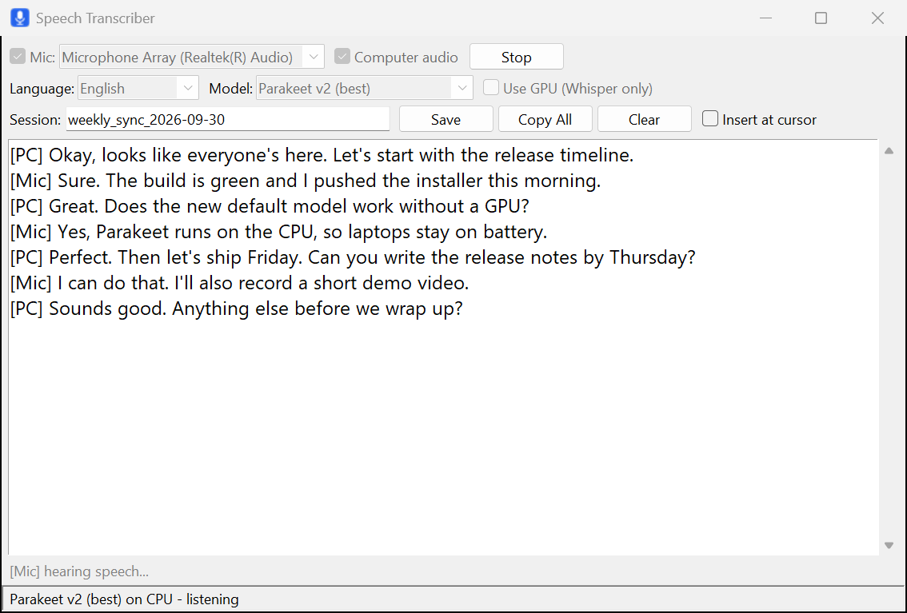
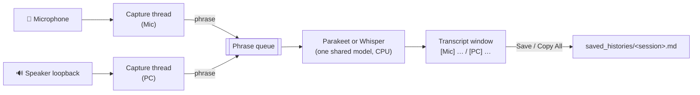
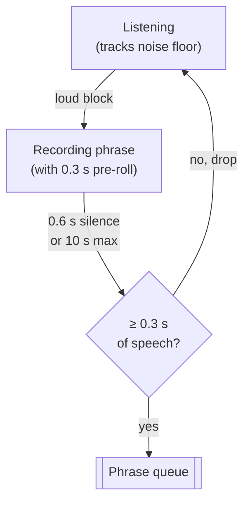

# Speech Transcriber

Offline live transcription of mic + PC audio. You're `[Mic]`, the call is `[PC]`;
save as Markdown for an LLM to summarize.



**Overview page:** https://anoted.github.io/audio_transcript/

## Features

- Transcribes the mic and a WASAPI loopback of the default speaker simultaneously
- Runs locally — no audio leaves your machine
- **Battery friendly:** everything runs on the CPU with a few threads; the GPU is never touched
  unless you tick **Use GPU** (Whisper only)
- **Language → Model** dropdowns:

  | Language | Models | Notes |
  |---|---|---|
  | English (default) | **Parakeet v2** (default), Whisper `tiny.en` / `base.en` / `small.en` | Parakeet is more accurate than Whisper large-v3 and runs ~12× real time on 2 CPU threads |
  | Multilingual | **Parakeet v3** (25 European languages), Whisper `base` / `small` / `large-v3-turbo` | Language is auto-detected; Whisper covers ~100 languages |

  Parakeet ([NVIDIA](https://huggingface.co/nvidia/parakeet-tdt-0.6b-v2)) runs as int8 ONNX via
  [onnx-asr](https://github.com/istupakov/onnx-asr); Whisper via
  [faster-whisper](https://github.com/SYSTRAN/faster-whisper).
- **Edit while it listens:** new text continues right after the last transcribed text, wherever
  your cursor is, and the view only auto-scrolls when you're already at the bottom. Tick
  **Insert at cursor** to have it typed at the cursor instead.
- **Save** (Ctrl+S) writes `saved_histories/<session>.md`; **Copy All** puts the same text on the clipboard
- The saved file starts with an instruction block asking an LLM for a summary, key decisions and next steps

## How it works



Each capture thread cuts its audio into phrases like this:



1. Each source is recorded in 100 ms blocks at 16 kHz on its own thread.
2. A running noise floor decides what counts as "loud". Speech starts a phrase; 0.6 s of
   silence ends it (after 5 s it's cut at the next short pause, hard cut at 10 s, so text
   shows up within a few seconds even during nonstop speech). Blips under 0.3 s are dropped.
3. Finished phrases go into one shared queue and a single speech model transcribes them in
   arrival order, typically 0.1–0.4 s after the phrase ends. A tiny VAD (Silero) skips
   non-speech first, so noise costs almost nothing.
4. Text lands in the window tagged with its source. The gray line under the transcript shows
   what's happening live (`hearing speech…`, `transcribing…`).

## Install and run

The first run downloads the selected speech model (into `~/.cache/huggingface`; Parakeet is
~650 MB); after that it works offline.

**Windows: download the exe (no Python needed)**

Grab `transcriber.exe` from the [latest release](https://github.com/anoted/audio_transcript/releases/latest)
and run it. Transcripts are saved to `saved_histories\` next to the exe.

**Windows: from source** (Python 3.10+)

```bat
run.bat             & rem add --gpu to also install the CUDA libraries for "Use GPU"
```

The first run creates `.build-venv` and installs `requirements.txt` into it; later runs
reinstall only when a requirements file changed.

Build your own `dist\transcriber.exe` with `build.bat`.

**Linux** (`setup.sh` and `run.sh` are for Linux only)

```bash
./setup.sh          # add --gpu to also install the CUDA libraries
./run.sh
```

> Computer-audio capture relies on loopback recording, which works out of the box with
> WASAPI on Windows and PulseAudio/PipeWire monitor sources on Linux.

### Power and GPU

Parakeet (2 threads) and Whisper (4 threads, int8) run on the CPU by default, so a laptop's
discrete GPU can stay asleep on battery. Parakeet on the CPU is slightly faster than Whisper
`base.en` (~0.5 s vs ~0.65 s per 6 s phrase) and more accurate than any Whisper size listed here.

**Use GPU** (Whisper only) needs CUDA 12 cuBLAS and cuDNN 9, from `run.bat --gpu` /
`./setup.sh --gpu` (`requirements-gpu.txt`). If the GPU can't be used, the app runs on CPU and
the status bar says `GPU unavailable`.

## Saved file format

```markdown
# weekly_sync_2026-09-30

Saved: 2026-09-30 15:00

## Instruction:

Make a Markdown report on what was discussed. What are the next steps? ...

## RAW:

[PC] Okay, looks like everyone's here. Let's start with the release timeline.
[Mic] Sure. The build is green and I pushed the installer this morning.
```

## License

[MIT](LICENSE)
